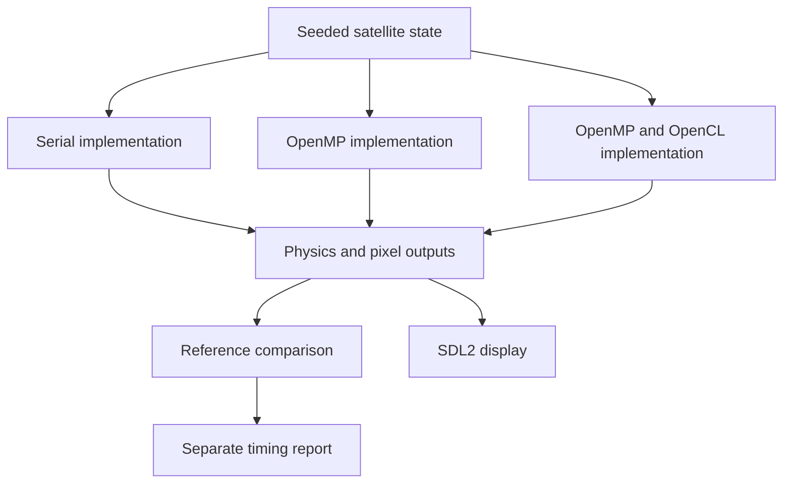

# GPU-Accelerated Satellite Simulation: design record

## Purpose

Compare serial, OpenMP and OpenMP plus OpenCL implementations of a gravitational simulation.

## Elements

| Element | Documentation boundary |
| :-- | :-- |
| Satellite state | Included in the stated project scope. Implementation details need the corresponding source or design file. |
| Physics update | Included in the stated project scope. Implementation details need the corresponding source or design file. |
| Pixel computation | Included in the stated project scope. Implementation details need the corresponding source or design file. |
| SDL2 display | Included in the stated project scope. Implementation details need the corresponding source or design file. |

## Technical stack

- C
- OpenMP
- OpenCL
- SDL2
- CMake

## Boundaries

The inspected CPU source calculates gravity from one black-hole center. It does not sum gravity between every satellite pair. The physics work scales with satellite count and the graphics work includes pixel-by-satellite loops. The previous generic all-pairs O(N²) description does not describe this source. No speedup value is asserted here without its run conditions.

## Decisions to recover

Record each design decision with its problem, selected option, rejected options and supporting artifact. Keep the original model or source revision with the record.

## Work decomposition

The inspected serial source has separate `parallelPhysicsEngine` and `parallelGraphicsEngine` functions. Physics updates satellite position and velocity relative to the black-hole center. The graphics function iterates over pixels and satellites to determine color.

The source includes initial-frame reference checks and separate physics, pixel and total timing output. Keep these checks enabled when validating a new parallel version. Compare compute time and total frame time separately.

Recorded reports are available in `results/Part1-OpenMP.pdf` and `results/Part2-OpenCL.pdf`. Their detailed measurements were not extracted during this update. The prior README named Mehdi Moallemkolaei and Md Ashfak Haider Nehal as authors. The exact division of work still needs a contribution record.
